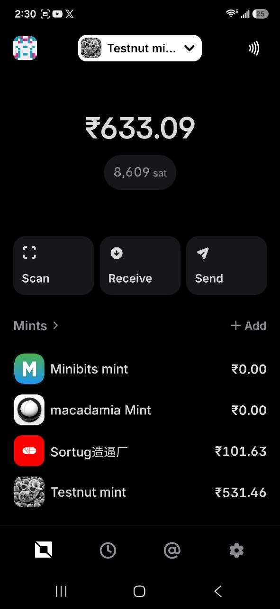
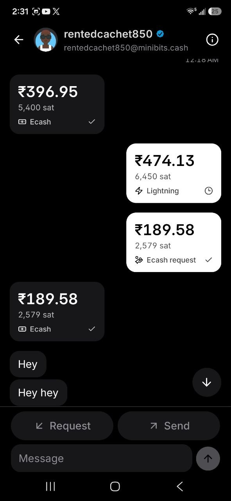
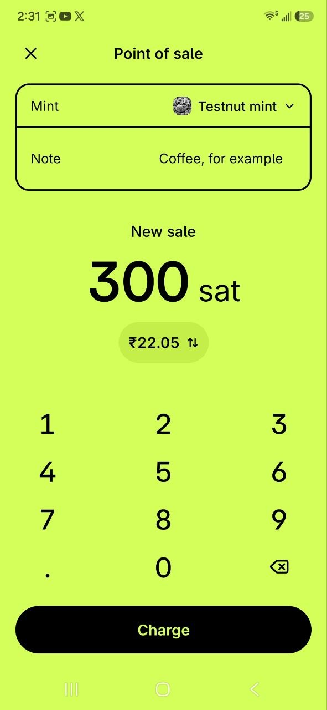
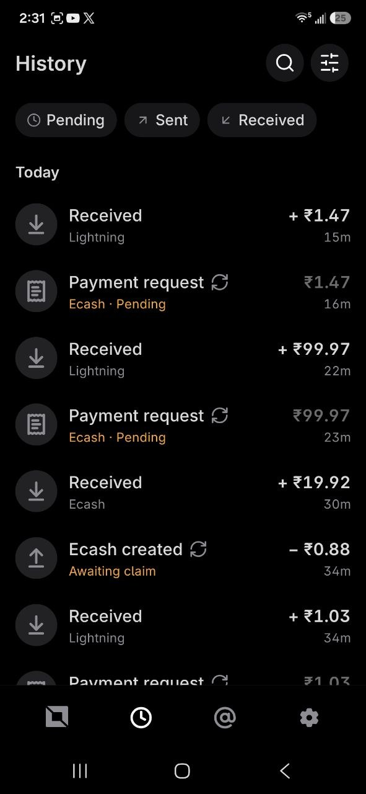
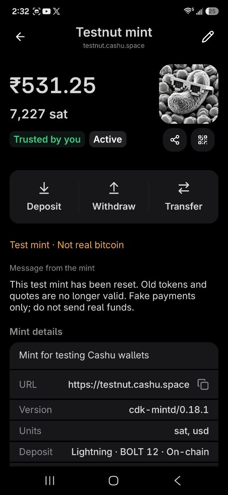
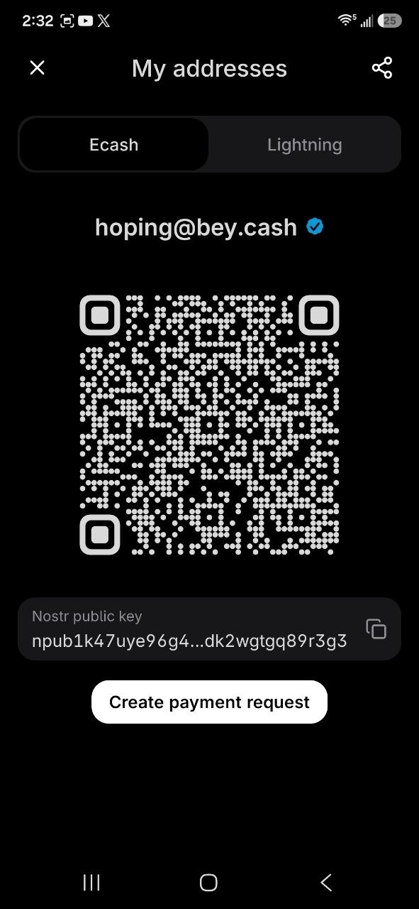

# Bey Wallet

**Bitcoin payments, Cashu ecash, and Nostr conversations in one wallet.**

[](LICENSE)
[](https://expo.dev)
[](https://reactnative.dev)
[](https://cashu.space)

Bey is a local-first wallet for everyday payments. Hold ecash across multiple mints, pay over
Lightning or Bitcoin, send money inside encrypted conversations, and accept payments through
a dedicated point-of-sale flow. Your recovery phrase, wallet state, and payment records stay
under your control on your device.

[Features](#features) · [Getting started](#getting-started) · [Development](#development) ·
[Documentation](#documentation) · [Contributing](CONTRIBUTING.md)

## Features

### Payments: ecash, Lightning, and Bitcoin

- **Send and receive Cashu ecash**, with ordinary bearer tokens and public-key-locked (P2PK)
  payments for a specific recipient.
- **Create and pay payment requests**, with amounts, notes, QR codes, and payment status.
- **Fund your wallet with Lightning** by creating an invoice at a compatible mint; collect ecash
  once the invoice has been paid.
- **Pay Lightning invoices and Lightning addresses**, with amount, destination, and fee review.
- **Receive and send on-chain Bitcoin** through mints that support the required operations.
- **Share payments** through QR codes, token copy, and the system share sheet. Large ecash tokens
  can use animated QR codes; the scanner also supports animated token input.
- **Track pending payments** and check status, collect, claim, or reclaim funds where the saved
  payment state permits it.

Payment methods depend on the capabilities and availability of the selected mint. A saved invoice,
delivered token, or relay acknowledgement does not by itself mean a payment has settled.

### People and encrypted conversations

- **Find people by Nostr public key or NIP-05 address**, with local matches and online profile
  discovery, verified identity badges, profile pictures, and generated avatars.
- **Manage contacts and requests** through Recent and Requests views, contact acceptance,
  blocking, and red numeric unread badges.
- **Chat over Nostr**, using NIP-17 by default or explicitly selected legacy NIP-04 compatibility.
  Messaging works with compatible Nostr clients, rather than a Bey-only account directory.
- **Send ecash and request payments inside a conversation**. Contacts with a published Lightning
  address also offer a Lightning send option; Lightning invoices can be shared as requests.
- **See messages and payments together**, with amount-first payment cards, compact status icons,
  currency conversion, and separate message/payment details.
- **Read longer conversations comfortably** with a virtualized timeline, older-message loading,
  sender/time grouping, and a floating jump-to-latest control.
- **Keep typing across navigation** with per-conversation session drafts, a growing multiline
  composer, and keyboard-aware layout. Drafts clear when the message session ends.
- **Long press for actions**: copy, select text, inspect details, or retry eligible failed messages.
- **Choose who can send to you**: ask before receiving from unknown people, or accept everyone
  except blocked people. Contact acceptance and mint approval remain separate.

NIP-04 is a compatibility option with public sender/recipient metadata. A message marked
**Sent to relay** confirms publication, not delivery or reading. See
[People and Nostr](docs/features/people-and-nostr.md) for the complete receiving policy.

### Identity and reusable receiving addresses

- A **wallet-derived Nostr identity**, restored from the wallet's recovery phrase.
- An optional **`@bey.cash` NIP-05 username**, with profile and identity verification.
- **My addresses**, with separate Ecash identity and Lightning views, QR codes, copy, and share.
- An opt-in **`npub1…@npub.cash` Lightning address**, backed by a compatible trusted receiving mint.
- **Automatic or manual Lightning-address collection**, pending-payment management, and an
  explicit check for payments to a previous npubx.cash address.
- **Relay management and diagnostics** for profile metadata, NIP-05, inbox relay lists, and
  connectivity, with focused repair actions.

The Lightning address is separate from the `@bey.cash` username. Its receiving mint can also be
different from the mint selected on Home. See [Lightning addresses](docs/lightning-address.md).

### Point of sale

Open **Receive → Point of sale** to accept a payment without leaving the wallet.

1. Enter the sale amount in sats or your selected fiat currency, choose a mint, and add a note.
2. Tap **Charge** and offer **Ecash** or **Lightning** from the same checkout.
3. Show the QR code or use supported Ecash NFC receiving. Switching payment methods preserves
   the sale and its existing request/invoice.
4. After verified receipt, tap **Next sale** to clear the amount and note while keeping the mint.

When fiat is selected for POS input, the keypad enters cents: typing `1234` gives `12.34`.
Backspace removes one digit. Sats remain whole numbers; other payment screens keep normal
decimal entry. A valid exchange rate is required before charging a fiat amount.

Tap **POS** beside the History title to switch between wallet activity and POS activity.
The text toggle is muted when off and has no background. Search and filters apply only to the
selected view. New POS requests and Lightning invoices are marked locally so their later
receipts stay in POS history, including after checkout closes. Older unmarked payments remain
in wallet history; the app does not guess their origin from the amount or note.

POS has its own lime-and-black interface, prominent amounts, and rounded payment controls.
Lightning NFC advertisement is not currently supported; Lightning checkout uses its invoice QR
and copy actions.

### Mints and wallet maintenance

- **Connect multiple mints** and inspect their balances, information, and supported capabilities.
- **Discover mints** through MintRadar and Nostr recommendations, then explicitly choose which
  mints to trust.
- **Transfer between mints** using compatible Lightning mint/melt operations, with a destination
  amount, fee review, and one linked Transfer receipt.
- **Choose a fallback mint** and a separate Lightning-address receiving mint.
- **Prepare offline change** and optimize fragmented ecash proofs.
- **Inspect proofs**, filter by mint/state, and verify supported proof signatures offline.
- **Review wallet maintenance activity**, including change preparation, optimization, and recovery,
  alongside payment history.

Cashu balances are claims on their issuing mints. Offline signature verification cannot establish
whether a token has already been spent; that requires checking with its mint.

### Nearby and offline payments

- **NFC payment flows** for compatible devices and wallets, including Android request
  advertisement and supported token exchange.
- **Offline ecash send readiness**, with nearby payable lower/higher amounts when existing local
  coins cannot make the exact amount.
- **Receive ecash for later processing** when connectivity is unavailable, subject to the normal
  trust and validation checks when online.
- A shared NFC sheet with request review, delivery retry, and payment-state recovery.

NFC capabilities vary by platform, hardware, and the other wallet. Offline sending uses available
coins; mint-backed change preparation and final redemption require connectivity. See
[NFC compatibility](docs/nfc-compatibility.md) for tested behavior and remaining device checks.

### History and receipts

- **Search saved history** by contact, note, amount, mint, payment type/status, and date.
- Combine search with **direction, mint, date, payment-type, and wallet-maintenance filters**.
- Open **compact receipts for settled payments** and full-screen views for pending or
  review-needed operations.
- Inspect status, timestamps, notes, recipient details, known fees, and on-chain explorer links.
- Expand **technical details** when needed, with complete copyable values and available validated
  Lightning payment proofs.
- **Preview and share receipt images**, keeping spendable ecash sharing a separate explicit action.

### Backup, recovery, and device controls

- **Create a wallet or restore from a recovery phrase**, with compatible mint recovery and
  progress tracking.
- **Export and restore wallet files**, including the recovery phrase, spendable ecash, and wallet
  records. Exported files are **not encrypted**; store them securely and never share them.
- **Publish your mint list to Nostr**, manually or automatically, so mint URLs can be found during
  recovery. This public list contains neither the recovery phrase nor spendable ecash.
- Check backup status and run a **manual funds-recovery scan**. Recovery depends on mint support,
  retained data, and availability; a mint-list backup is not a full wallet backup.
- **Biometric/device authentication**, app lock, protected recovery-phrase/private-key screens,
  and a hide-balance preference.
- **Light, dark, or system appearance**, sats/fiat display, a sats-only mode, and a Bitcoin-symbol
  preference.
- **Notification controls** for payments, messages, review-needed events, and visible details.
  Fully closed-app receiving alerts are not currently supported.
- Camera scanning, deep links, Android launcher Scan/Receive shortcuts, app-update checks, and
  an optional **Support Bey** Lightning contribution flow.

## Screenshots

<p align="center">
  
  
  
</p>
<p align="center">
  
  
  
</p>

## Getting started

The native app is built with Expo and React Native. Use a development build for native features;
Expo Go or a browser alone cannot validate NFC, biometrics, notifications, or native payment flows.
Android has custom NFC/HCE integration. iOS and web support differ and require their own checks.

### Requirements

- Node.js compatible with Expo SDK 54.
- **Yarn 4.5.0**, pinned in `package.json`.
- Android Studio and a JDK for local Android builds, or Xcode on macOS for iOS.
- EAS CLI and the appropriate Expo/signing access for hosted native builds.

### Run locally

```bash
git clone https://github.com/Bey-Wallet/BeyWallet.git
cd BeyWallet
yarn install
yarn android
```

For iOS, use `yarn ios` on macOS. Once a compatible development client is installed, start Metro
with `yarn start` and open that client. Rebuild it when native dependencies or configuration change.

On an 8 GB machine, use `yarn start:low-memory` and a physical device. It keeps Metro's cache,
uses one worker, and gives the Expo Node process a 3 GB heap. EAS can handle native builds without
running Gradle alongside Metro. See [development memory notes](docs/development-memory.md).

### Hosted Android builds

```bash
# Development client: connects to Metro
eas build -p android --profile development

# Internal preview APK
eas build -p android --profile preview

# Production APK
eas build -p android --profile production
```

Build profiles live in [eas.json](eas.json). Native device testing is required before treating a
build as verified for payments or device integrations.

## Development

### Commands

| Command                       | Purpose                                                |
| ----------------------------- | ------------------------------------------------------ |
| `yarn start`                  | Start Expo with the existing Metro cache               |
| `yarn start:low-memory`       | Start Metro with one worker and a 3 GB Node heap       |
| `yarn start:clean`            | Start Expo with an explicit cache reset                |
| `yarn android` / `yarn ios`   | Build and run the native app                           |
| `yarn web` / `yarn build:web` | Develop or export the web target                       |
| `yarn typecheck`              | Check TypeScript without emitting files                |
| `yarn test:ci`                | Run Jest once                                          |
| `yarn check:structure`        | Check route wrappers and feature ownership             |
| `yarn check:buttons`          | Check shared button conventions                        |
| `yarn validate`               | Run type checking, tests, structure, and button checks |
| `yarn format:check`           | Check repository formatting                            |

Reset Metro's cache only when needed. There is no package lint command; the repository uses
Prettier for the wired formatting checks.

### Architecture

| Location                            | Responsibility                                            |
| ----------------------------------- | --------------------------------------------------------- |
| `src/app/`                          | Thin Expo Router entry points                             |
| `src/features/`                     | Feature screens, flows, and owned components              |
| `src/shared/`                       | Shared UI, themes, hooks, icons, and utilities            |
| `src/services/wallet/`              | Cashu operations and wallet lifecycle orchestration       |
| `src/services/platform/`            | Device and native integrations                            |
| `src/services/api/`                 | Remote service clients                                    |
| `src/state/`                        | Zustand stores                                            |
| `src/storage/sqlite/`               | Local database, migrations, and repositories              |
| `tests/unit/`, `tests/integration/` | Focused behavior and integration tests                    |
| `android/`, `plugins/`, `patches/`  | Native Android code, Expo plugins, and dependency patches |

The stack includes **TypeScript, Tamagui, Expo Router, Zustand, TanStack Query, Expo SQLite,
Cashu/Coco packages, and nostr-tools**. Internal imports use the `~/*` alias.

## Documentation

- [Documentation index](docs/README.md) and [architecture guide](docs/folder-structure.md)
- [People, Nostr, and receiving policy](docs/features/people-and-nostr.md)
- [Lightning addresses](docs/lightning-address.md)
- [NFC flow](docs/nfc-sheet.md) and [Android interoperability](docs/nfc-compatibility.md)
- [Mint transfers](docs/transfer-verification.md)
- [Transaction receipts](docs/transaction-receipts.md) and [wallet activity](docs/wallet-activity.md)
- [Appearance](docs/appearance.md) and [fonts](docs/fonts.md)
- [Notifications](docs/notification-manual-testing.md) and
  [People/payment device checks](docs/testing/nostr-people-checklist.md)
- [Changelog](CHANGELOG.md)

## Contributing and support

Read [CONTRIBUTING.md](CONTRIBUTING.md) before making changes. Keep wallet changes focused,
preserve security checks, and document both automated validation and remaining device tests.
Use [GitHub Issues](https://github.com/Bey-Wallet/BeyWallet/issues) for reproducible bugs and
feature proposals.

Never include recovery phrases, private keys, spendable tokens, proofs, backup files, or credentials
in issues, logs, screenshots, tests, or commits. Voluntary Lightning support is available through
**Support Bey** in the app.

## License

Copyright 2026 Bey Wallet.

Bey Wallet is licensed under the **GNU Affero General Public License, version 3 only**
(`AGPL-3.0-only`). See [LICENSE](LICENSE) for the complete terms and warranty disclaimer, or the
[SPDX license reference](https://spdx.org/licenses/AGPL-3.0-only.html).

Third-party components retain their own licenses and notices. The bundled Inter fonts are
licensed separately under the [SIL Open Font License 1.1](src/assets/fonts/Inter-OFL.txt).
