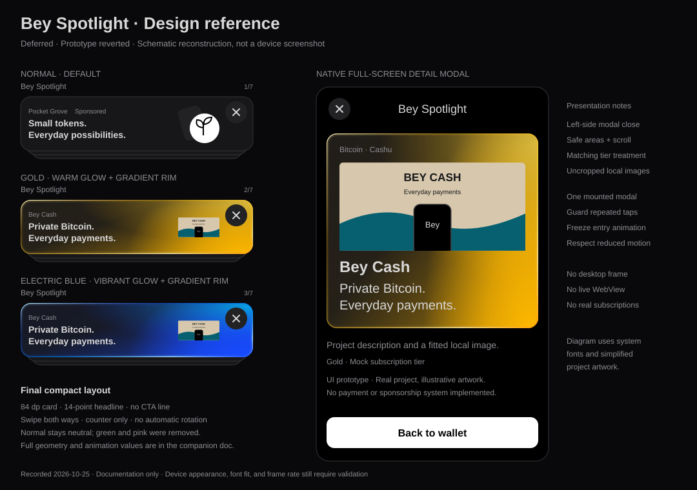

# Bey Spotlight design reference

Status: **Deferred — prototype reverted.** Recorded 2026-10-25.

Spotlight was a UI experiment for discovering Bitcoin, Cashu, Nostr, and independent developer
projects. The user removed its implementation and deferred monetizing Home placements. This
document preserves the final design from that experiment; it does not describe a live feature
or authorize restoring it. The current application remains the source of truth.

The illustration is a schematic reconstruction, not a device screenshot. It uses simplified
artwork and system fonts. No screenshot of the final prototype was retained, and Android
performance and visual fit were not verified on a device.

## Placement and final content

- Use one placement on Home, directly below the balance and Scan/Send/Receive controls, within
  Home's existing horizontal padding. Reserve space for the complete stack; do not overlap the
  following wallet cards.
- Show one foreground card with two partially visible cards behind it. A fourth, initially
  invisible layer can fill the back of the stack during a swipe.
- Keep the small `Bey Spotlight` heading and a dynamic counter such as `2/7` above the stack.
  There are no previous/next arrow buttons and no automatic carousel rotation.
- Each card contains the project name, an optional small Sponsored label, a short headline, and
  artwork on the right. The final revision removed the separate CTA/description line, including
  “Preview bey.cash,” “Discover…,” and its chevron. Do not restore that line when recreating it.
- X in the card's top-right hides the entire placement. This in-card control is distinct from
  the left-side X in the standalone detail modal.

The final mock ordering was Pocket Grove (normal), Bey Cash (gold), Bey Cash (blue), Minibits
Mint (blue), Cashu.me (blue), Open Workbench (blue), and Orbit Notes (blue). The first, sixth,
and seventh projects were fictional. All placement tiers and sponsorship labels were mock data.
Minibits was described as a **test mint**; Cashu.me's detail copy distinguished iOS TestFlight
from Android Google Play. Recheck those external facts before future reuse.

## Geometry, text, and surfaces

| Element                 | Final prototype recipe                                                                  |
| ----------------------- | --------------------------------------------------------------------------------------- |
| Foreground height       | `Math.max(84, 84 * fontScale)` dp                                                       |
| Corners                 | Tamagui `rounded="$6"`, corresponding to the app's 16 dp card radius                    |
| Card padding            | 12 dp horizontally, 6 dp vertically                                                     |
| Text/art layout         | Centered horizontal row, 8 dp gap, 40 dp reserved on the right for dismissal            |
| Text block              | Flexible width, `minWidth={0}`, vertically centered, 4 dp between metadata and headline |
| Metadata                | 10-point text, 12-point line height; project name at weight 500, Sponsored at 400       |
| Headline                | `$heading`, 14-point text, 18-point line height, weight 600                             |
| Artwork slot            | 64 × 56 dp, centered; decorative and excluded from accessibility navigation             |
| Header                  | 12-point label, 10-point counter, 4 dp gap before the stack                             |
| Stack height            | Foreground height + 12 dp                                                               |
| Layer transform at rest | `translateY = depth * 6`, `scale = 1 - depth * 0.045`                                   |
| Dismiss control         | Shared `HeaderIconButton`, top/right 4 dp, 22-point X, minimum 48 dp touch area         |

Use Inter Text for UI copy and Inter Display for large text/amounts, in 400/500/600 with
`tnum`, `ss01` and `ss04` defaults (normal zero). Keep native text scaling, wrap
metadata where necessary, and validate small phones and larger accessibility sizes. The fixed
art slot and reserved dismiss area must not compress or obscure the headline. See
[appearance conventions](../appearance.md) for the rest of the design system.

The normal treatment uses `$buttonDefaultSecondary`, its existing hover/pressed surfaces,
`$color` for headlines, `$gray10` for metadata, and `$borderColor` for its subtle 1 dp border.
Blue and gold are deliberate, local promotional-artwork exceptions to the monochrome palette;
they do not change the app theme. Green and pink treatments were explicitly removed.

### Colored background recipe

Render static SVG gradients using the already-installed `react-native-svg`. Clip them to the
card corners, give each SVG instance unique gradient IDs, and make every overlay ignore touch
and accessibility events. Static color pools move with the animated card; no blur filter or
continuous glow animation is needed.

| Treatment     | Main tint | Highlight |
| ------------- | --------- | --------- |
| Electric blue | `#174BFF` | `#00D4FF` |
| Gold          | `#FFB800` | `#FFE258` |

Layer these over the normal card fill, preserving a relatively dark/quiet left text area:

1. **Wash:** linear gradient from `(0%, 0%)` to `(100%, 70%)`. At offsets 0%, 45%, and
   100%, use the main tint with dark-mode opacity 0.04, 0.06, and 0.55. Light-mode opacity
   is 0.02, 0.03, and 0.35.
2. **Lower glow:** radial gradient centered at `(96%, 104%)`, radii `(50%, 140%)`. Main-tint
   opacity at 0% is 1 in dark mode and 0.7 in light mode. At 40%, use 0.8 for blue or 0.7
   for gold; fade to zero at 100%.
3. **Upper bloom:** radial gradient centered at `(100%, 5%)`, radii `(48%, 95%)`. Start with
   the highlight at opacity 0.7 for blue or 0.65 for gold; fade to transparent main tint.

### Glowing gradient border

Both electric blue and gold have the same border construction, also used on the modal's
project panel. Normal has no colored rim.

| Stop | Opacity | Blue      | Gold      |
| ---- | ------- | --------- | --------- |
| 0%   | 1       | `#B9F3FF` | `#FFF3BC` |
| 30%  | 0.35    | `#174BFF` | `#FFB800` |
| 58%  | 0.7     | `#008CFF` | `#FFCD38` |
| 82%  | 1       | `#B9F3FF` | `#FFF3BC` |
| 100% | 1       | `#174BFF` | `#FF9500` |

Use a diagonal `(0%, 0%)` → `(100%, 100%)` SVG linear gradient. Draw two full-size rounded
rectangles with no fill: an 8 dp stroke at 0.12 opacity for the inner halo, and a 2.5 dp
stroke for the crisp rim. Match the 16 dp radius. The parent clips the outer half of each
stroke, so this is an inner glow, not a shadow outside the stack. Make the ordinary colored
card border transparent so it does not compete with the rim.

## Local images and detail presentation

The prototype bundled the following official assets, rather than fetching them at runtime.
The assets were reverted with the code and are **not** restored by this reference:

| Project       | Original asset URL                            | Use                                            |
| ------------- | --------------------------------------------- | ---------------------------------------------- |
| Bey Cash      | <https://bey.cash/SEO/Website-ScreenShot.png> | Same 1896 × 902 website image in gold and blue |
| Minibits Mint | <https://minibits.cash/icon-192.png>          | Official square Minibits logo                  |
| Cashu.me      | <https://cashu.me/images/og-cashu-me-v2.jpg>  | Official wallet social-preview image           |

Use `expo-image` with `contentFit="contain"` and `transition={0}`. Compact previews occupy
the 64 dp-wide artwork slot with a 1896/902 frame ratio, allowing square logos to fit inside
it. In details, resolve the local asset's actual aspect ratio and cap the image height at
200 dp. Keep images uncropped, without browser dots, a desktop frame, or a fake address bar.
Use the project name in the full-size image's accessibility label. Artwork for fictional
projects used an existing icon on a circular monochrome tile over a slightly tilted neutral
tile, displayed at half scale in the compact slot.

Tap the foreground card to open a full-screen **React Native Modal**, reusing
`AppFullScreenModal`. The detail view uses:

- Canvas background, safe-area padding, centered `Bey Spotlight` title, and a left-side X.
- A scrollable body with 16 dp page padding and existing spacing tokens.
- A rounded project panel: category and optional `Sponsored · Mock` label, larger fitted image
  or artwork, 24-point/600 project title, and 20-point/500 headline. Reuse the selected tier's
  glow and rim on this panel.
- A 14-point description, a 12-point mock-tier label, and a clear disclosure distinguishing
  real projects from fictional examples. A `Back to wallet` button simply closes the modal.
- Android hardware-back dismissal and no live installs, payments, mint connections, or website
  requests. The preview is local content, not a WebView.

### Modal-opening lesson

The user reported a double-opening/lag sensation. A **likely cause**, not a device-confirmed
diagnosis, was a newly mounted reduced-motion hook starting at `true` and later resolving to
`false`, changing the native modal's animation from `none` to `slide` during presentation.

The final mitigation kept one native modal mounted with a changing `visible` flag, reused the
parent's loaded motion preference, and captured that preference for the whole presentation.
A synchronous ref guarded repeated taps before React committed selection state. Close cleared
selection and the guard. Regression tests covered rapid taps, stable modal identity, close/reopen,
and a motion-preference change during presentation.

The reverted shared modal currently has a fixed slide animation. Recreating this treatment
would require restoring an optional `animationType` prop with the existing slide default;
this document makes no change to that component.

## Gesture and visibility behavior

Use the existing Reanimated and Gesture Handler dependencies. A horizontal pan activates after
14 dp and fails if vertical movement exceeds 12 dp before activation, allowing Home scrolling.
Advance left to the next project and right to the previous one, wrapping around the mock list.
During dragging, switch backing content to match the current direction.

Let `progress = min(abs(translationX) / cardWidth, 1)`. Backing layers advance from `depth` to
`depth - progress`, using the same scale and offset formula. The front translates with the
finger, rotates by up to `7 * translationX / cardWidth` degrees, and fades from opacity 1
at 75% progress to 0 at 100%. The fourth layer fades in with progress.

Commit when distance exceeds 22% of the card width or absolute horizontal velocity exceeds
650 dp/s. Animate the front to 1.15 card widths offscreen in 230 ms. Guard transitions, advance
the React index on completion, and reset translation/guard after the next card is committed.
Return unsuccessful or cancelled gestures with spring damping 22 and stiffness 240.

With reduced motion, switch cards without translation, scale, rotation, or presentation
animation. Preserve accessibility actions for next/previous when the visual arrow controls
are absent, announce the counter politely, and hide backing cards from screen readers.

The temporary `Show Spotlight` switch lived on a dedicated Settings → Preferences → Bey
Spotlight screen using the normal Settings group and branded `AppSwitch`. A session-only
Zustand preference defaulted to visible. X and the toggle shared that preference; re-enabling
restored the stack, and an app restart reset the temporary preference. No account or storage
migration was introduced.

## Revisit checklist

- Get a new product decision before restoring any feature code or selling placements.
- Check fit at 320/360/400 dp screen widths, large text sizes, and both themes; inspect contrast
  across the bright glows, image fit, complete stack height, and the dismiss touch area.
- Verify horizontal swipes against vertical scrolling, direction changes, partial swipes,
  cancellation, rapid taps, wrapping, hardware back, reduced motion, and hiding/restoring.
- Repeat the modal regressions above and verify behavior on an Android device. The previous
  passing mocked tests did not establish frame rate or prove the reported sensation resolved.
- Keep recovery, payments, mint validation, wallet balances, and Nostr transaction behavior
  untouched. A paid mint placement must never imply a safety guarantee or alter mint trust.
- Keep sponsorship clearly labeled, with no balance/contact/transaction targeting. Production
  delivery, pricing, analytics, sales, subscriptions, and payment collection remain unspecified.
